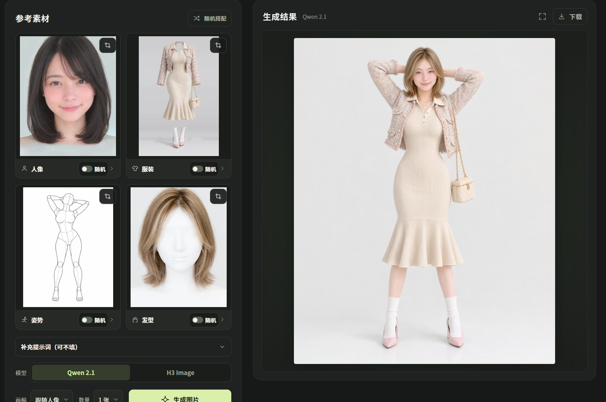
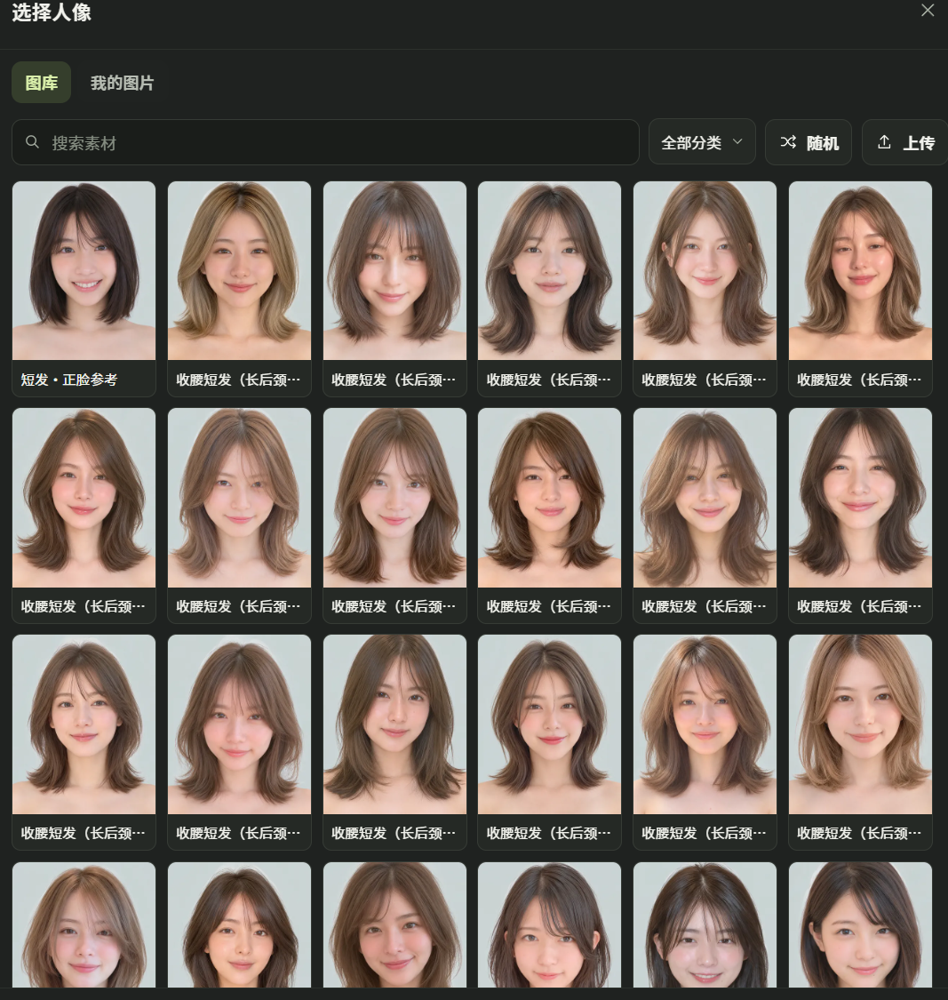
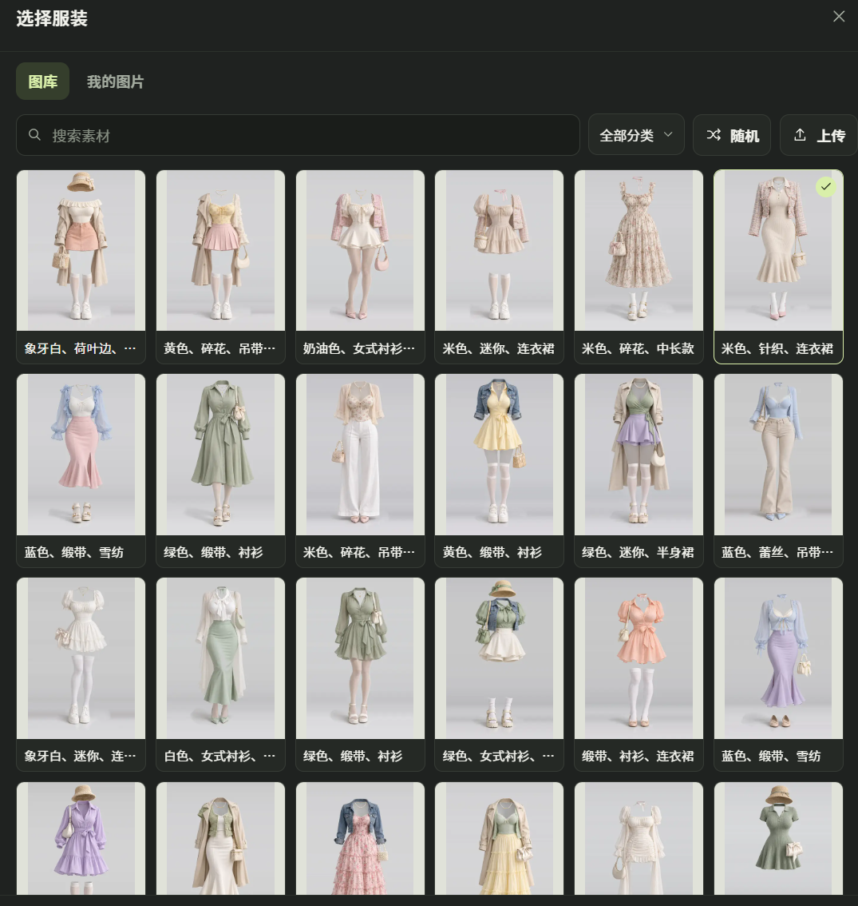
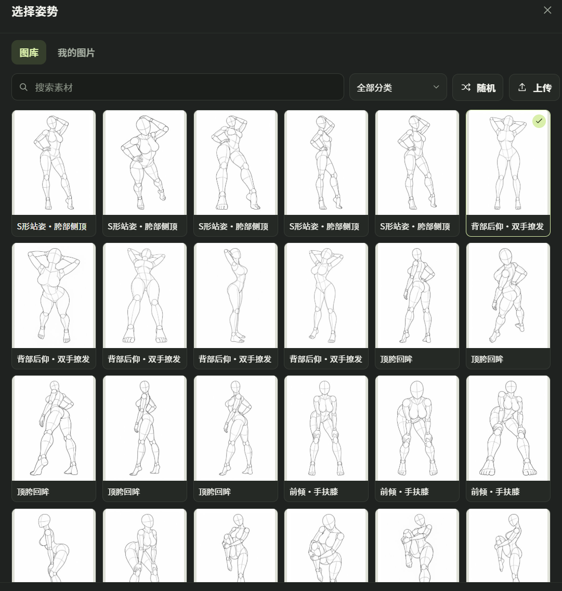
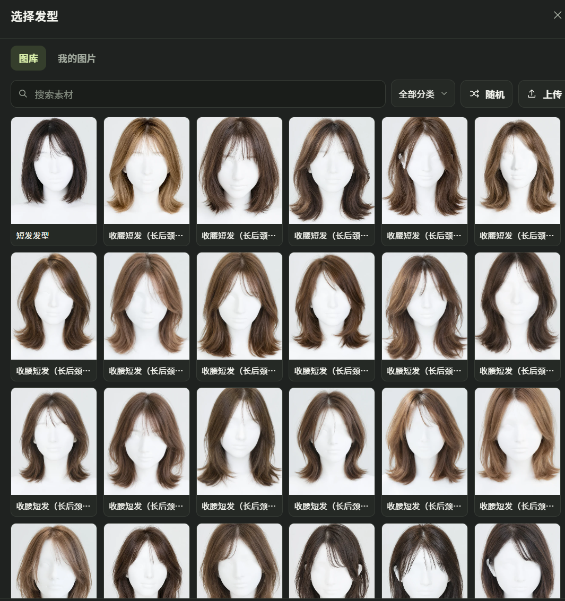

<p align="center">
  
</p>

<h1 align="center">造型工作台</h1>

<p align="center">
  用人像、服装、姿势和发型参考图，生成一套新造型。<br>
  基于本地 ComfyUI，支持 Qwen Image 2.1 和 MiniMax H3 Image INT8。
</p>

<p align="center">
  <a href="#功能">功能</a> ·
  <a href="#素材库">素材库</a> ·
  <a href="#快速开始">快速开始</a>
</p>

<p align="center">
  <a href="docs/images/workbench.png"></a>
</p>

## 功能

| 功能 | 使用方式 |
| --- | --- |
| 四类参考素材 | 在人像、服装、姿势和发型库中搜索、分类筛选或随机挑选。也可上传自己的 JPG、PNG 或 WebP 图片。 |
| 裁剪参考图 | 双击已选图片或点卡片右上角的裁剪图标，调整范围和比例。应用后，卡片和模型都使用裁剪后的图像。 |
| 提示词 | 根据已选素材组合套用预设模板。Qwen 会结合参考图细化提示词，H3 Image 使用工作流内置的英文模板。想指定额外细节时，可填写补充提示词。 |
| 批量生成 | 一次提交 1–8 张。Qwen 使用固定参考时可以两张一组并行采样。启用随机素材或使用 H3 Image 时逐张生成。 |
| 预览与下载 | 通过缩略图切换批次结果，支持放大、逐张下载和在当前浏览器查询生成记录。 |

每类素材的随机开关独立控制。开启后，每张结果都从对应图库重新抽取该类素材。关闭时使用卡片上的选图和裁剪。打开或刷新页面时，四个随机开关均为关闭。

## 素材库

| 人像 | 服装 |
| :---: | :---: |
| <a href="docs/images/portrait-gallery.png"></a> | <a href="docs/images/costume-gallery.png"></a> |

| 姿势 | 发型 |
| :---: | :---: |
| <a href="docs/images/pose-gallery.png"></a> | <a href="docs/images/hair-gallery.png"></a> |

图库截图展示已安装 GHIL 素材包的界面。上传的图片会出现在当前浏览器的「我的图片」里，可在任一参考位复用。

## 快速开始

**在已有的本地 ComfyUI 环境中部署。** 仓库提供网页、服务端和两套工作流配置。运行前需准备能执行对应工作流的 ComfyUI、GHIL 图库、缺失节点和模型权重。

1. 在包含 `ComfyUI/` 和 Python 虚拟环境 `.venv/` 的父目录中克隆项目。

   ```bash
   git clone https://github.com/ZR-AI/Modeling-workbench.git qwen-web
   ```

   网页服务复用父目录的 `.venv`，需要 `aiohttp` 和 `Pillow`。图库从 `ComfyUI/models/GHIL/` 读取。完整工作流配置见 [Qwen](workflow.json) 和 [H3 Image](workflow-h3-image.json)。

2. 启动 ComfyUI，再在父目录启动网页服务。

   ```bash
   ./qwen-web/start.sh
   ```

   在已有父目录 `start-comfyui.sh` 和用户级 systemd 的 Linux 环境中，也可运行 `./qwen-web/start-all.sh` 一次启动两个服务。

3. 在服务器本机打开 [127.0.0.1:8190](http://127.0.0.1:8190/)。同一局域网的其他设备可用服务器的局域网 IP 和端口 `8190` 访问。

<details>
<summary>模型文件与数据位置</summary>

| 目录（相对于 `ComfyUI/models/`） | Qwen Image 2.1 | MiniMax H3 Image INT8 |
| --- | --- | --- |
| `diffusion_models/` | `qwen_image_2.1_int8_convrot.safetensors` | `minimax_h3_image_pruned_int8_convrot.safetensors` |
| `text_encoders/` | `qwen3vl_8b_int8_convrot.safetensors` | `qwen3vl_32b_minimax_h3_nvfp4_awq.safetensors` |
| `vae/` | `qwen_image_2.1_vae_bf16.safetensors` | `minimax_h3_image_vae_fp16.safetensors` |

Qwen 的提示词优化器还需要 `models/LLM/` 中的 `Qwen-Image-2.1-PE-T2I.Q5_K_S.gguf`、`Qwen-Image-2.1-PE-I2I.Q5_K_S.gguf` 和 `Qwen-Image-2.1-PE-I2I.mmproj-bf16.gguf`，以及节点依赖的 `llama-cpp-python` 和 `diskcache`。

- 上传图片（单张 ≤ 12 MB）：`ComfyUI/input/qwen-web/`
- 生成结果：`ComfyUI/output/QwenWeb/`
- 网页服务数据和启动日志：`qwen-web/.data/`

</details>
